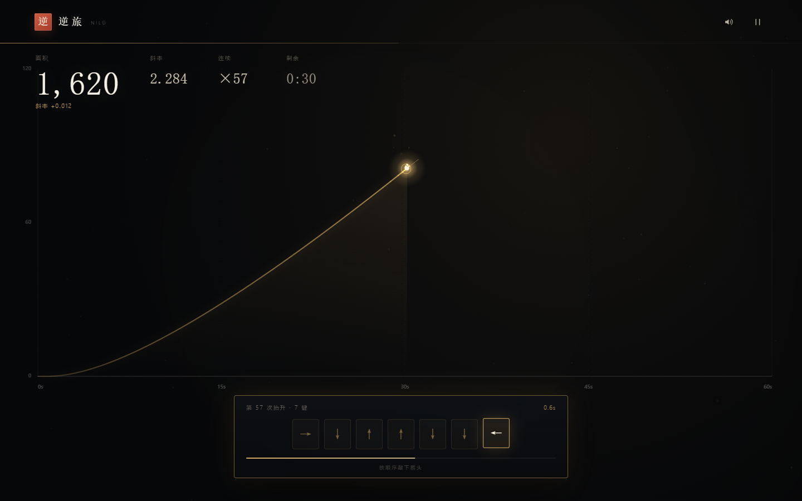
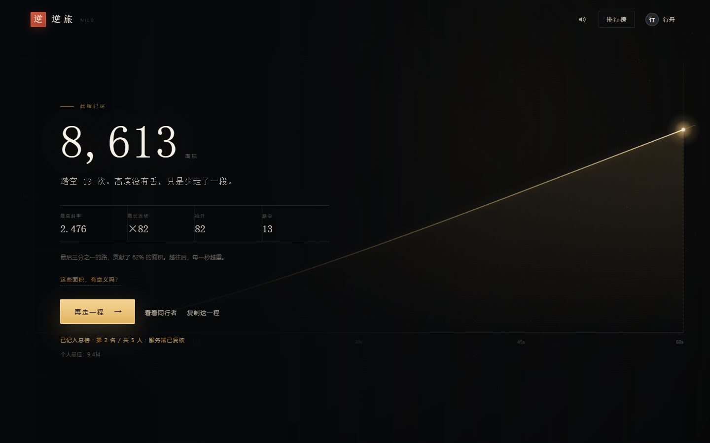
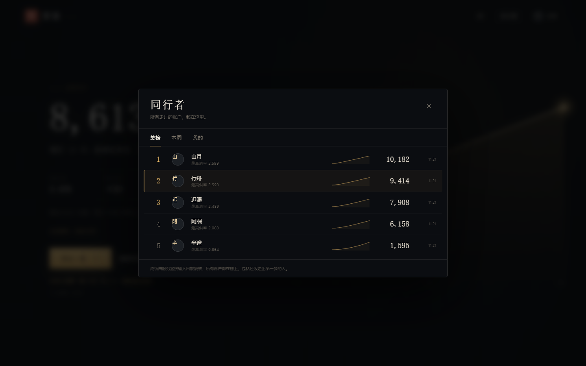
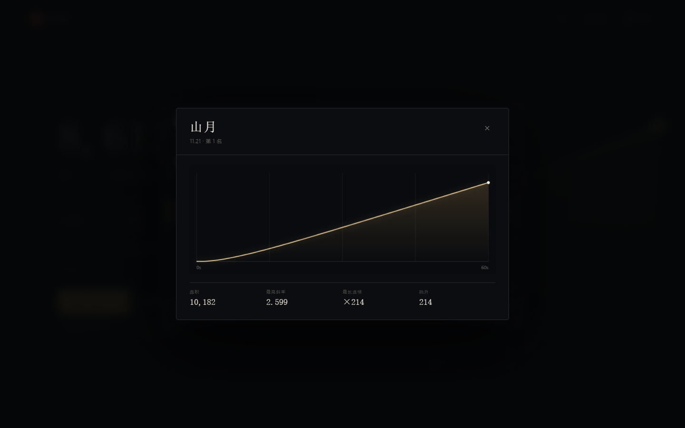

# 逆旅 · NILÜ

> 人生如逆旅，我亦是行人。

一个只能向前的光点。六十秒里，按顺序敲下箭头，每次成功都会让它的斜率微微抬高。**轨迹之下的面积，就是这一程。**

[在线试玩](https://joffzxf.github.io/nilu/) · [架构说明](docs/architecture.md) · [小红书开发日志](docs/xhs/)



---

## 这是什么

- 光点从左往右走，**不能回头**。
- 每完成一组方向键指令，斜率上升一点；指令会越来越长、给键时间越来越短。
- 失误不会扣掉已经抬起来的高度，只损失时间。
- 60 秒后，成绩是 `∫ y dx`，也就是轨迹下的面积。
- 没有登录也能玩；登录 GitHub 后，每一程由服务器回放复核，所有账户进入同一个排行榜。

设计上刻意保留了两件事：

1. **分数主要来自「时间 × 高度」的复利**：越早抬头，后面每一秒越值钱。
2. **失败只让你少走一段，不会抹掉已经到达的高度**：这是游戏，也是我想表达的那一点东西。

---

## 现在能玩到什么

- 60 秒完整一局：固定 60Hz 模拟、渐进的指令难度、连击、喘息、结算。
- 桌面键盘 `← ↑ → ↓`，手机四键触控。
- Canvas 轨迹：斜率、面积填充、成功刻痕、失误标记、结束扫描。
- 本地模式：无后端也能玩，本机最佳与最近 20 程。
- 账号模式：GitHub 登录、服务器回放复核、总榜/周榜/我的轨迹。
- 榜单详情：点开任意一条轨迹，看别人的曲线和统计。
- 奖励式细节：暂停、声音、复制成绩、无后端时自动降级。
- 所有账户都在榜上，包括 0 分和还没走出第一步的人。

### 截图

| 行走中 | 这一程 |
| --- | --- |
|  |  |

| 同行者 | 一条轨迹 |
| --- | --- |
|  |  |

---

## 本地运行

需要 Node.js 22+（用到 `node:sqlite`）。

```bash
git clone https://github.com/joffzxf/nilu.git
cd nilu
cp .env.example .env
npm start
```

打开 <http://127.0.0.1:8787/>。

`.env.example` 默认 `DEV_AUTH=1`，所以不配置 GitHub OAuth 也能体验完整账号流程：

1. 点右上角「登录」。
2. 点「本地测试登录」。
3. 走一程，结算会显示「服务器已复核」与名次。

想清空本地数据：删除 `data/nilu.db`。

### 不启动服务，只看页面

```bash
python -m http.server 8788
```

打开 <http://127.0.0.1:8788/>。没有 API 时自动进入本地模式，成绩只留在这台设备。

### 测试

```bash
npm test
npm run check
```

当前覆盖：

- 同 seed + 同输入 → 完全一致的回放。
- 斜率/面积/连击/超时/喘息。
- 输入日志校验（同 tick 多键、乱序、越界）。
- 登录 → 发凭证 → 回放复核 → 上榜。
- 幂等提交、凭证过期、越权提交。
- 所有账户上榜、0 分账户、周榜、我的记录、轨迹详情。
- OAuth 未配置、开放重定向拦截、CORS 预检。

---

## 接入账号与排行榜

前端是纯静态的，账号与排名需要一个 API。仓库里给了两套运行方式，共用同一份业务代码：

- **Cloudflare Worker + D1**：推荐，免费、无服务器。
- **Node + SQLite**：自托管/本地开发。

五分钟版本：

```bash
npx wrangler d1 create nilu
npx wrangler d1 execute nilu --file server/schema.sql --remote
npx wrangler secret put GITHUB_CLIENT_ID
npx wrangler secret put GITHUB_CLIENT_SECRET
npx wrangler deploy
```

然后把 `assets/js/config.js` 里的 `apiBase` 改成 Worker 地址，推送页面。

完整的 OAuth App 配置、环境变量、回滚与冒烟步骤见 **[docs/architecture.md](docs/architecture.md)**。

> 安全边界：服务器能保证「这份输入确实得到这个分数」，不能保证「输入来自人类」。回放不是万能反作弊，别在宣传里说「绝对防挂」。

---

## 目录

```text
.
├─ index.html                 页面结构
├─ assets/
│  ├─ css/style.css           视觉系统
│  ├─ img/                    favicon / OG
│  └─ js/
│     ├─ engine.js            确定性引擎（浏览器 + 服务器共用）
│     ├─ render.js            Canvas 轨迹/光点/粒子
│     ├─ main.js              状态机、输入、账号、榜单
│     ├─ api.js               API 客户端
│     ├─ audio.js             WebAudio 合成音
│     └─ config.js            API 地址 / 仓库地址
├─ server/
│  ├─ app.js                  路由、OAuth、回放、排行榜
│  ├─ store-sql.js            SQL（SQLite / D1 共用）
│  ├─ driver-sqlite.js        Node 驱动
│  ├─ driver-d1.js            D1 驱动
│  ├─ node.js                 本地 Node 服务（静态 + API）
│  ├─ worker.js               Cloudflare Worker 入口
│  └─ schema.sql              DDL
├─ tests/                     引擎 + API 测试
├─ tools/seed-demo.mjs        本地演示数据（仅本地使用）
├─ docs/
│  ├─ architecture.md         架构、威胁模型、部署
│  ├─ design-notes.md         玩法与设计取舍
│  ├─ assets/                 截图
│  └─ xhs/                    小红书开发日志与封面
└─ wrangler.toml              Worker / D1 配置
```

---

## 设计笔记

### 为什么分数是面积，而不是「最高斜率」

斜率是瞬间，面积是它经过的时间。

一次抬头如果发生在第 10 秒，它后面的 50 秒都在为你累积；发生在第 55 秒，只值 5 秒。**早一点努力，复利更明显。** 这比「最高分」更接近我想说的东西。

### 为什么失败不扣高度

光点不会回头，但也不该因为一次踏空就否定已经走过的路。

失误的代价是时间：指令中断、进入喘息、下一组重来。高度保留，面积少一点。结算页会说：「高度没有丢，只是少走了一段。」

### 为什么有「喘息」

如果难度只跟成功次数走，一个手慢的玩家会陷入「超时 → 更长指令 → 再超时」的死循环。

连续失误后，下一组会变短、窗口会变宽。这不是怜悯，是让逆旅继续。

### 为什么所有账户都在榜上

包括 0 分，包括还没走的人。

排行榜不只是给赢家看的。它也可以是一份「谁来过」的名单。这是产品决定，不是查询写错了。

### 为什么光点不能回头

因为时间不能。

---

## 开发日志 / 小红书

开发过程按版本整理成了可直接发布的小红书笔记：

- [发布计划与素材清单](docs/xhs/README.md)
- [01 · 光点不会回头](docs/xhs/01-光点不会回头.md)
- [02 · 所有走过的人，都在榜上](docs/xhs/02-所有走过的人都在榜上.md)
- [03 · 成绩不能自己说了算](docs/xhs/03-成绩不能自己说了算.md)

封面在 `docs/xhs/assets/`，和笔记一一对应。

---

## 状态

- [x] v0.1 页面 demo：光点、指令、斜率、面积、结算
- [x] v0.2 GitHub 登录、服务器回放、排行榜、我的轨迹
- [x] v0.3 架构文档、部署、测试、小红书素材
- [ ] 线上 API 部署（需要 Cloudflare / OAuth App 凭证）
- [ ] 引擎版本冻结与历史回放器
- [ ] 输入节奏特征 / Top N 复核
- [ ] 赛季、轨迹分享卡

线上 demo 目前是 **本地模式**（GitHub Pages 无 API）。部署 Worker 并把 `assets/js/config.js` 的 `apiBase` 指过去，就会自动切成账号模式。

---

## 说明

- 页面无构建、无第三方脚本、无外部字体；离线也能打开。
- 账号只读取 GitHub 公开用户名与头像，不读取仓库、邮箱或关注关系。
- `tools/seed-demo.mjs` 会在本地数据库创建测试账号，**不要在生产环境运行**。
- `DEV_AUTH=1` 只用于本地演示，线上必须关闭。
