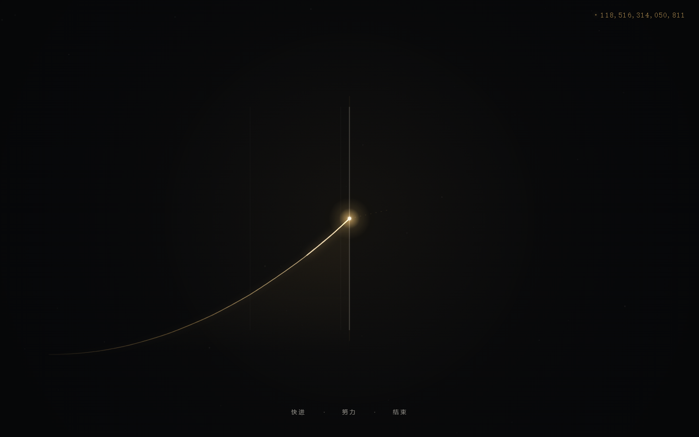

# 逆旅 · 一个光点的一生

> 现实一秒，游戏一秒。三万天，自动结束。

一个光点从第 0 天开始走。它一直在屏幕正中央，只有时间轴在移动。右上角有一个很小的数字，是轨迹下累积的面积。

页面上只有三个动作：

**[快进]　[努力]　[结束]**



---

## 它是什么

- **打开页面就开始了。** 没有开始按钮，没有教程，没有标题。
- **光点不回头。** 它固定在屏幕中央，过去的时间被压缩成左侧那条轨迹，未来的时间在右边。
- **现实一秒 = 游戏一秒。** 一生 30,000 天，约 82 年。关掉网页，时间也不会停；下次打开，它会按现在的斜率继续往前走。
- **右上角是面积。** 轨迹下累积的面积，每秒都在变。它最后会变成一个很难读懂的很大的数。
- **快进**：可以跳到当前天之后的任意一天（0–30000），只能向前。跳过的时间也会按当前斜率累积面积。到第 30,000 天，这一生结束，账号注销。
- **努力**：点开后出现一组方向键，没有时间限制，但必须按对。按错就要重新点「努力」。
- **结束**：主动结束这一生。会先让你确认：结束即注销，不能再回来。确认后光点消亡，页面只剩黑色。

> 这是游戏，不是隐喻考试。它不回答「人生有什么意义」，只把「时间、努力、面积」摆在一起。

---

## 两种模式

### 本机模式（当前线上 demo）

没有 API 时，页面把这一生存在浏览器的 `localStorage` 里：

- 关掉网页再打开，时间会补上。
- 只有这一台设备能看到。
- 适合直接打开就玩，也适合先看视觉。

线上地址：<https://joffzxf.github.io/nilu/>

### 账号模式（代码已完成，需要部署 API）

有 API 时，左上角会出现一个很小的账号入口：

- GitHub 登录，不注册、不存密码。
- 一个登录用户可以有多个「一生」，但同一时间只有一个还活着。
- 服务器按真实时间结算；关掉网页、换设备，时间都在走。
- 一局结束后，这一生进入墓碑状态，不能复活；下一次会开始新的一生。
- 所有分数、斜率、时间都由服务器算，前端只负责显示。

部署步骤见 **[docs/architecture.md](docs/architecture.md)**。没有你的 GitHub OAuth App 与 Cloudflare 凭证，我没有替你把线上 API 接上；线上目前是本机模式。

---

## 本地运行

需要 Node.js 22+。

```bash
git clone https://github.com/joffzxf/nilu.git
cd nilu
cp .env.example .env
npm start
```

打开 <http://127.0.0.1:8787/>。

`.env.example` 默认 `DEV_AUTH=1`。本地左上方会出现一个小圆点，点一下就会用本地测试账号登录，进入完整的一生/多生/服务器结算流程；不点就是本机模式。

不启动服务、只看页面：

```bash
python -m http.server 8788
```

打开 <http://127.0.0.1:8788/>。没有 API 时会自动使用本机模式。

### 测试

```bash
npm test
npm run check
```

覆盖：

- 时间结算、梯形积分、斜率与面积。
- 快进只能向前、到 30000 天结束。
- 努力没有时间限制、输错不增加斜率。
- 同一用户同时只有一个活着的一生。
- 结束后不能再用，下一次可以重新开始。
- 别人的努力不能提交。
- CORS、OAuth 未配置、开放重定向拦截。

---

## 目录

```text
.
├─ index.html                 极简页面：光点、面积、三个动作
├─ assets/
│  ├─ css/style.css           视觉
│  ├─ img/                    favicon / OG
│  └─ js/
│     ├─ life.js              一生引擎（浏览器 + 服务器共用）
│     ├─ render.js            Canvas：中央光点、压缩时间轴、轨迹
│     ├─ main.js              自动开始、本机/账号、三个动作
│     ├─ api.js               API 客户端
│     ├─ audio.js             合成音
│     └─ config.js            API 地址
├─ server/
│  ├─ app.js                  账号、结算、努力、快进、结束
│  ├─ store-sql.js            SQL（SQLite / D1 共用）
│  ├─ driver-sqlite.js        Node 驱动
│  ├─ driver-d1.js            D1 驱动
│  ├─ node.js                 本地 Node 服务（静态 + API）
│  ├─ worker.js               Cloudflare Worker 入口
│  └─ schema.sql              accounts / efforts / events / users
├─ tests/                     life + API
├─ docs/
│  ├─ architecture.md         时间权威、多人多生、部署
│  ├─ design-notes.md         为什么是三万天、三个动作
│  ├─ assets/                 截图
│  └─ xhs/                    一篇开发笔记与封面
└─ wrangler.toml
```

---

## 设计笔记

- **为什么是 30,000 天**：约 82 年，一个人的一生。不是 60 秒，所以不能靠重开逃避。
- **为什么是 1:1**：如果游戏时间比现实快，它就成了一个可以刷的游戏；只有一样快，关掉网页后它继续走这件事才有重量。
- **为什么光点在中央**：人永远在「现在」。过去被压缩在左边，未来是空的。
- **为什么只有三个动作**：快进、努力、结束。人生里能主动做的事，好像也就这几类。
- **为什么快进也给面积**：因为时间本身就会把斜率变成面积。快进不是作弊，是提前把时间花掉，也提前靠近终点。
- **为什么努力没有倒计时**：努力不是反应测试。你可以想很久，但必须做对；错了就重来。

更细的数值与取舍见 [docs/design-notes.md](docs/design-notes.md)。

---

## 小红书

这一版只写了一篇，不拆成开发者说明：

- [退出也不会停](docs/xhs/01-退出也不会停.md)
- [封面](docs/xhs/assets/01-cover.png)

旧的 60 秒版本笔记在 `docs/xhs/archive-v1/`，只作历史。

---

## 线上状态

- 页面：<https://joffzxf.github.io/nilu/>（本机模式，自动开始）
- 仓库：<https://github.com/joffzxf/nilu>
- 账号 API：代码完成并在本地 7,000 / 15,000 天全链路验证；线上需要部署 Worker + D1 和 GitHub OAuth App。
- 演示截图里是一份 20 年的本地样本，方便看见轨迹；新访客从第 0 天开始，页面是空的。
