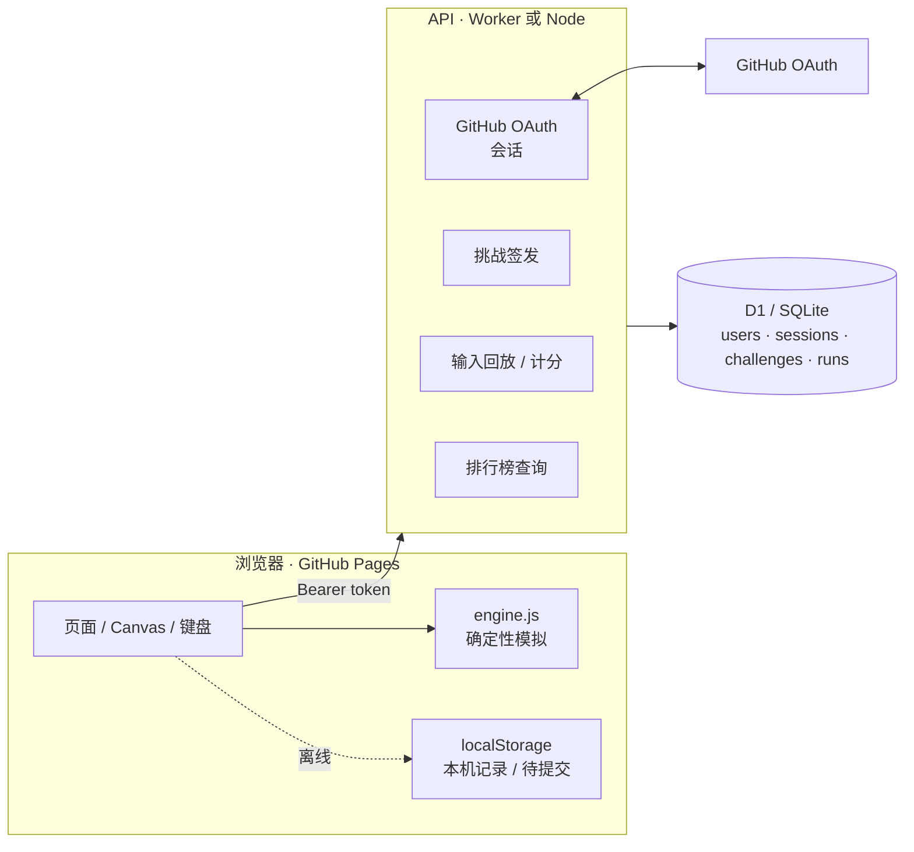
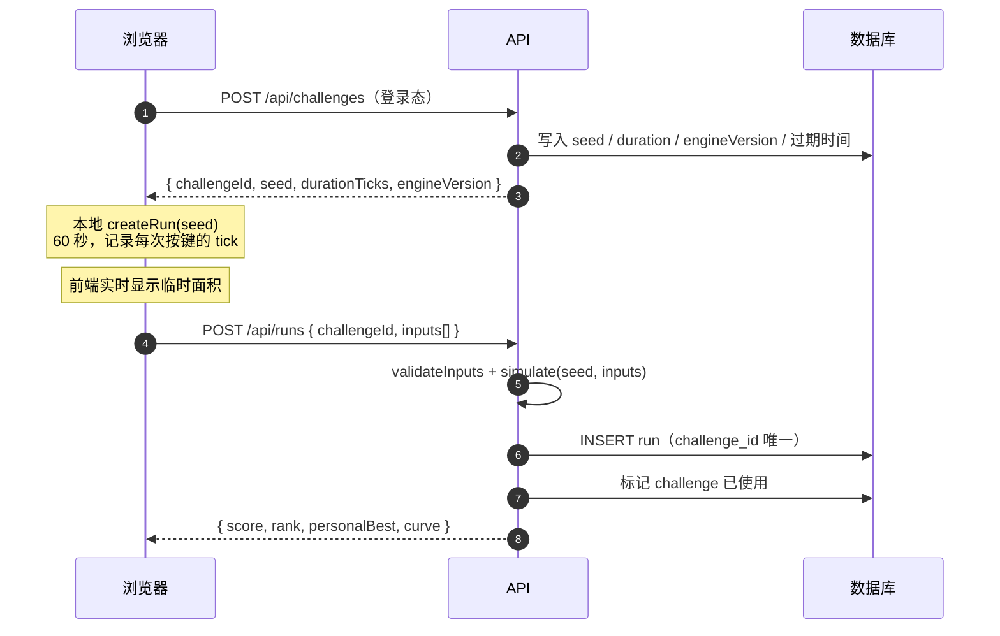

# 逆旅 · 架构说明

> 一个静态页面，一台小服务器，一套可回放的规则。

这篇文档回答一个问题：**「逆旅」要怎样实现，才既能放在 GitHub Pages 上让人随手打开，又能让所有账号的排名可信、长期可维护？**

---

## 0. 结论先行

推荐架构：

| 层 | 选择 | 理由 |
| --- | --- | --- |
| 前端 | 纯静态 HTML/CSS/ES Modules，GitHub Pages 托管 | 零构建、全球 CDN、免费、后端挂了也能玩 |
| 规则 | 浏览器与服务器共享一份确定性引擎 | 同一 seed + 同一输入 = 同一分数 |
| 账号 | GitHub OAuth（Authorization Code） | 不存密码，不碰邮箱，用户零注册成本 |
| 会话 | 服务端签发的随机 token，数据库只存哈希 | 避开第三方 Cookie 被浏览器拦截的问题 |
| 计分 | 服务器根据输入日志回放，不接受前端分数 | 前端算分等于让考生自己批卷 |
| 数据 | Cloudflare D1（或自托管 SQLite） | 免费额度足够、SQL 简单、可迁移 |
| 部署 | GitHub Pages + Cloudflare Worker | 没有常驻进程，运维面最小 |

真正重要的不是这套技术栈，而是三条原则：

1. **规则必须确定性**：给定种子和输入，任何机器、任何时间都算出同一个结果。
2. **分数必须由服务器算**：前端只负责「记录发生了什么」，不负责「这值多少分」。
3. **前端必须可降级**：账号服务不可用时，游戏仍然完整可玩，只是成绩留在本机。

---

## 1. 目标与非目标

### 目标

- 单局 60 秒，桌面键盘、手机触屏都能玩。
- 页面可以直接放在 GitHub Pages，不需要构建步骤。
- 用 GitHub 账号登录；所有登录过的账户都进入排行榜，包括 0 分和还没玩过的人。
- 服务器复核成绩，改前端、改 localStorage、改请求体都不能直接伪造分数。
- 单人开发也能维护：无服务器、无容器编排、无 Redis、无消息队列。
- 后端故障时优雅降级：本地模式仍可玩、可看本机记录。

### 非目标

- 实时多人对战、观战、房间。
- 绝对防住脚本/外挂。回放能证明「这份输入确实得到这个分数」，不能证明「输入来自人类」。
- 大规模社交（评论、关注、私信）。
- 完整的账号体系（邮箱、密码、找回、改绑）。

---

## 2. 总览



一次完整的行走：



---

## 3. 为什么不是纯前端

纯前端可以做 demo，但不能做「所有账户的可信排名」：

| 方案 | 问题 |
| --- | --- |
| 分数存 localStorage | 用户改一行 localStorage 就能当第一名 |
| 分数提交到静态接口 | GitHub Pages 没有动态接口；第三方表单无法校验 |
| GitHub Issues / Gist 当数据库 | 需要把 token 放前端；速率限制、并发、事务、滥用都不可控 |
| GitHub OAuth 纯前端换 token | OAuth 换 token 需要 client secret；GitHub token 端点也不支持浏览器 CORS |
| 直接上 VPS + MySQL | 可行，但对一个 60 秒小游戏来说运维过重：证书、备份、守护、扩容都要自己来 |

**结论**：页面可以静态，但「发凭证、验分数、存排名」这三件事必须有一个可信的服务端。

---

## 4. 确定性引擎：整个架构的地基

文件：`assets/js/engine.js`，同时被浏览器和服务器 `import`。

### 4.1 三条纪律

1. **不读真实时间**：引擎只认 `tick`。`TICK_MS = 1000/60`，60 秒 = 3600 tick。
2. **不读系统随机数**：所有指令序列由 `seed` 经 mulberry32 生成。
3. **不碰 DOM / 网络 / 存储**：输入是 `{ t, k }`，输出是分数和轨迹。

因此：

```js
simulate({ seed: 12345, durationTicks: 3600, inputs }) === simulate(同一组参数)
```

服务器不需要相信前端传来的 `score`、`area`、`slope`，只需要相信 `seed` 和 `inputs`，然后自己再跑一遍。

### 4.2 一个 tick 里发生什么

```text
1. 处理本 tick 的按键（最多一个）
   - 正确：prompt.index++
   - 完成整组：slope += gain，combo++，生成下一组
   - 错误：combo=0，进入 42 tick 的喘息
2. 超时检查：tick >= deadline → miss，进入喘息
3. 若当前没有指令且到了 nextPromptTick：生成下一组
4. 积分：y += slope·dx；area += y·dx；x += dx
5. tick++
6. 每 30 tick 采样一次轨迹，供榜单缩略图使用
```

### 4.3 输入协议

客户端每次按下方向键，记录：

```json
{ "t": 1834, "k": 2 }
```

- `t`：相对本局开始的 tick，整数。
- `k`：0 左、1 上、2 右、3 下。

服务器强制：

- `t` 严格递增（同一 tick 只允许一个键，否则一秒七键的脚本可以作弊）。
- `0 <= t < durationTicks`。
- `k in [0,3]`。
- 最多 4096 个输入。

### 4.4 难度与分数

- 第 `level` 次成功后，下一组长度 `len = min(7, 2 + floor(level/6))`。
- 每组给键时间随 level 缩短，但保留一个最低值。
- 连续失误会触发「喘息」：下一组变短、窗口变宽。失败不会扣高度，只损失时间。
- 得分 `score = round(∫ y dx)`，即轨迹下的面积。
- 斜率有上限 `SLOPE_CAP = 2.6`；越接近上限，单次提升越小。

这些参数都在 `engine.js` 顶部/`difficultyFor()` 里，改动它们等于改游戏版本。

### 4.5 版本化

`ENGINE_VERSION = '1.0.0'` 会写进 challenge 和 run。

- 复核时必须使用「签发这个 challenge 时的引擎版本」。
- 当前代码只保留一个版本；如果以后修改规则，应把旧引擎冻结为 `engine/v1.js`，按 `run.engine_version` 选择回放器。
- 否则新引擎回放旧 run，会得到不同分数，历史榜单就不可解释。

这是一个容易被忽略、但一旦上线就必须面对的问题。

---

## 5. 一局的生命周期

### 5.1 发凭证

`POST /api/challenges`（必须登录）：

- 每用户每小时最多 120 次。
- 作废此前未使用的 challenge，保证「一人同时只有一局」。
- 生成 32 位随机 seed、15 分钟有效期、引擎版本、时长。
- 返回 `challengeId`、`seed`、`durationTicks`、`engineVersion`。

客户端拿到 seed 后才 `createRun()`，所以玩家无法自选种子刷高分。

### 5.2 本地行走

- 浏览器用 `requestAnimationFrame` 累积时间，`advance()` 固定 60Hz 推进。
- 按键记录 tick；窗口失焦/暂停时 `pausedTotal` 会扣掉，回放仍按 tick 计算，暂停不会被算成游戏时间。
- 页面显示的面积是**临时值**，结算时会被服务器结果覆盖。

### 5.3 提交与幂等

`POST /api/runs`：

1. 校验登录、challenge 归属、未使用、未过期、引擎版本一致。
2. 校验输入日志。
3. 要求距离签发至少 `duration × 0.8`（防「秒交」；暂停会让实际时间更长，不影响）。
4. `simulate()` 重放，得到服务器分数。
5. 先 `INSERT run`（`challenge_id` 唯一），再标记 challenge 已用。
6. 若插入撞唯一键，说明并发/重试，直接返回已存在的 run。

为什么先插入再标记？因为即使标记那一步失败，run 已经存在；下一次重试会命中唯一键并返回已有结果，不会产生两条记录。

### 5.4 重试

- 客户端网络失败时把 `{challengeId, inputs}` 放进 localStorage。
- 下次打开页面、且仍登录时自动补交。
- challenge 15 分钟内有效；过期就放弃，本地成绩保留。

---

## 6. 防作弊：能防什么，不能防什么

### 6.1 已实现

| 攻击 | 防护 |
| --- | --- |
| 改前端分数 | 服务器不读前端 score，只回放输入 |
| 改 localStorage | 排行榜只读数据库；本地记录不参与总榜 |
| 自选 seed / 刷高分种子 | seed 由服务器签发 |
| 重放旧请求刷榜 | challenge 一次性；run 对 challenge 唯一 |
| 一秒打七个键 | 输入 tick 必须严格递增 |
| 提交别人的局 | challenge 绑定 userId |
| 无限领凭证 | 每小时限额 + 同时只保留一局 |
| 秒交脚本 | 最短真实耗时校验 |
| 超大数据包 | body 256KB、输入 4096 条上限 |
| SQL 注入 | 全部 prepared statement |
| 开放重定向 | return URL 必须在 `APP_ORIGIN` 白名单 |

### 6.2 防不住

**脚本可以生成完美输入。**

回放解决的是「这份输入是否真的得到这个分数」，不是「这份输入是否由人类打出」。一个知道 seed 和引擎的脚本，可以生成和高手一样的输入日志。

要再往前一步，需要：

- 输入节奏的统计特征（键间隔分布、反应时间下限、抖动）；
- 客户端完整性/attestation；
- 对 Top N 做人工复核或录屏；
- 赛季制 + 举报机制。

这些都不是第一版必须做的。**不要在文案里宣称「绝对防作弊」**，那是不诚实的。

### 6.3 威胁模型

| 角色 | 能力 | 我们的态度 |
| --- | --- | --- |
| 普通玩家 | 改前端、改 localStorage | 防住 |
| 好奇的开发者 | 看源码、构造请求 | 能防住改分数，防不住完美脚本 |
| 有动机的刷榜者 | 自动化、多账号 | 限流 + 人工复核，接受残余风险 |
| 恶意攻击者 | DDoS、撞库 | 交给 Cloudflare / GitHub OAuth，不在应用层硬扛 |

---

## 7. 账号与会话

### 7.1 为什么是 GitHub OAuth

- 目标用户有 GitHub 账号；不用再注册。
- 不存密码，不存邮箱，数据面最小。
- 只请求 `read:user`，读取公开的 `id / login / name / avatar_url`。

### 7.2 流程

```text
浏览器                      API                         GitHub
  |  GET /auth/github/start   |                            |
  |-------------------------->|  存 state + nonce + return  |
  |  302 github.com/authorize |                            |
  |<--------------------------|                            |
  |  用户授权                                             |
  |  GET /auth/github/callback?code&state                  |
  |-------------------------->|  换 access_token ---------->|
  |                           |  读 /user ---------------->|
  |                           |  upsert user               |
  |                           |  生成一次性 login_code      |
  |  302 页面#login=code&nonce |                            |
  |<--------------------------|                            |
  |  POST /auth/exchange      |                            |
  |-------------------------->|  校验 code，发 session token |
  |<--------------------------|                            |
```

### 7.3 为什么不用 Cookie

前端在 `github.io`，API 在 `workers.dev`，属于跨站。

- `SameSite=Lax` 的 Cookie 不会随跨站 fetch 发送。
- `SameSite=None` 需要 `Secure`，且 Safari/Firefox 默认拦截第三方 Cookie，Chrome 也在推进限制。
- 把 API 放到自定义域名下同站部署可以解决，但会增加域名/证书/部署复杂度。

因此使用 **Authorization: Bearer**：

- token 是 32 字节随机数，数据库只存 SHA-256。
- 有效期 90 天，可退出、可删除。
- 前端放 localStorage；代价是 XSS 风险。
- 页面没有第三方脚本，CSP 限制 `script-src 'self'`，所有用户内容用 `textContent` 渲染，不用 `innerHTML` 拼接用户输入。

这是一个明确的取舍：**用可接受的 XSS 风险，换跨浏览器可靠的登录态。**

### 7.4 登录 CSRF

攻击者可以自己发起 OAuth，拿到一个合法 `login_code`，诱导受害者打开带 code 的链接，从而把受害者登录成攻击者的账号。

防护：

- 前端生成随机 `nonce`，存 sessionStorage，随 start 请求发给服务端。
- 服务端把 nonce 和 state 一起存。
- 回调把 nonce 带回；前端必须比对 sessionStorage 里的 nonce 才 exchange。

攻击者不知道受害者浏览器里的 nonce，所以无法完成。

### 7.5 隐私

- 只存 GitHub 公开资料：`github_id`、`login`、`name`、`avatar_url`。
- 不存邮箱、access token、密码。
- GitHub access token 只在回调过程中使用，用完即弃。
- 退出登录删除会话；数据库里的 runs 保留（排行榜需要），但可以加「删除我的数据」接口。

---

## 8. 数据模型

```sql
users(id, github_id, login, name, avatar_url, created_at, updated_at)
sessions(token_hash, user_id, created_at, expires_at, user_agent)
login_states(state, nonce, return_url, created_at, expires_at)
login_codes(code_hash, user_id, created_at, expires_at, used_at)
challenges(id, user_id, seed, duration_ticks, engine_version,
           created_at, expires_at, used_at)
runs(id, challenge_id UNIQUE, user_id, score, area, max_slope,
     successes, misses, max_combo, duration_ticks, engine_version,
     inputs_json, curve_json, created_at)
```

索引：

- `runs(user_id, score DESC, created_at ASC)`：个人最佳。
- `runs(score DESC, created_at ASC)`：总榜。
- `runs(created_at)`：周榜。
- `challenges(user_id, created_at DESC)`：限流。

### 8.1 排行榜查询

「每个账户取最好的一局，所有人的 0 分也保留」：

```sql
SELECT u.id, u.login, u.name, u.avatar_url,
       COALESCE(r.score, 0) AS score, ...
FROM users u
LEFT JOIN runs r ON r.id = (
  SELECT id FROM runs
  WHERE user_id = u.id
  ORDER BY score DESC, created_at ASC
  LIMIT 1
)
ORDER BY CASE WHEN r.id IS NULL THEN 1 ELSE 0 END,
         r.score DESC, r.created_at ASC, u.login ASC
LIMIT ? OFFSET ?;
```

`LEFT JOIN` 是刻意的产品决定：**所有账户都在榜上**，包括还没走出第一步的人。这不是「排行榜」，更像一份「同行者名单」。

### 8.2 周榜

按 **Asia/Shanghai 周一 00:00** 切分。SQLite 里只存 UTC 毫秒，周界在应用层算。

### 8.3 扩展性

当前查询在几千用户内没问题。再往上：

1. 提交成功时更新 `leaderboard_best(user_id, score, run_id)` 物化表。
2. 总榜读物化表，周榜用 `(season_id, score)` 索引。
3. 再大就上 Redis Sorted Set / 只读副本。
4. 不要过早做这些；先让游戏有人玩。

---

## 9. 可靠性与降级

### 9.1 三层降级

| 层 | 故障 | 表现 |
| --- | --- | --- |
| 静态页 | API 全挂 | 仍可打开、仍可玩，成绩只进本机 |
| 账号 | OAuth 失败 / token 过期 | 提示重新登录；本局仍可完成 |
| 提交 | 网络失败 / 超时 | 本机保留成绩 + pending，下一次补交 |

### 9.2 故障模式

| 故障 | 影响 | 处理 |
| --- | --- | --- |
| Worker 冷启动慢 | 首屏多等 1–2 秒 | 静态页先渲染；凭证请求有 loading 态 |
| D1 暂时不可用 | 无法发凭证/提交 | 降级本地；提示稍后再试 |
| GitHub OAuth 不可用 | 无法登录 | 老 token 仍有效；游客可玩 |
| challenge 过期 | 无法提交 | 本地成绩保留；提示「这一程未被记入」 |
| 重复提交 | 可能双写 | challenge_id 唯一 + 幂等返回 |
| 客户端时钟漂移 | 输入 tick 偏移 | tick 由本地 `performance.now` 推，服务器只信日志；不影响复核 |
| 旧引擎回放 | 分数不一致 | 版本冻结；按 engine_version 选回放器 |

### 9.3 运维清单

- `/api/health`：引擎版本、OAuth 是否配置、当前时长。
- 访问日志：请求方法、路径、状态码、耗时（Node）。
- 每周导出一次 D1 数据（`wrangler d1 export`）。
- 修改 schema 用迁移文件，不直接改线上表。
- 每次部署后跑一次冒烟：health → dev login（仅测试环境）→ challenge → submit → leaderboard。

---

## 10. 部署

### 10.1 前端（GitHub Pages）

1. 把仓库推到 GitHub。
2. Settings → Pages → Source: `Deploy from a branch` → `main` / `/ (root)`。
3. 访问 `https://<user>.github.io/nilu/`。
4. 根目录的 `.nojekyll` 防止 Jekyll 处理文件。

不需要构建。所有路径都是相对路径。

### 10.2 API（Cloudflare Worker + D1）

```bash
npx wrangler d1 create nilu
# 把 database_id 填进 wrangler.toml
npx wrangler d1 execute nilu --file server/schema.sql --remote
npx wrangler secret put GITHUB_CLIENT_ID
npx wrangler secret put GITHUB_CLIENT_SECRET
npx wrangler deploy
```

`wrangler.toml` 里改：

- `APP_ORIGIN = "https://<user>.github.io"`
- `API_ORIGIN = "https://<worker>.workers.dev"`
- `GITHUB_CALLBACK_URL = "https://<worker>.workers.dev/api/auth/github/callback"`

### 10.3 GitHub OAuth App

GitHub → Settings → Developer settings → OAuth Apps → New OAuth App：

- Homepage URL：`https://<user>.github.io/nilu/`
- Authorization callback URL：与 `GITHUB_CALLBACK_URL` 完全一致
- 只勾选 `read:user` 相关范围（OAuth App 默认即可）

### 10.4 前端接上 API

编辑 `assets/js/config.js`：

```js
export const CONFIG = {
  apiBase: 'https://nilu-api.xxx.workers.dev',
  repoUrl: 'https://github.com/<user>/nilu',
  pagesUrl: 'https://<user>.github.io/nilu/',
};
```

重新提交后，页面会探测 `/api/health`；探测成功才进入账号模式。

### 10.5 自托管（Node + SQLite）

不想用 Cloudflare 也可以：

```bash
cp .env.example .env      # 填 OAuth / DEV_AUTH
npm start                 # http://127.0.0.1:8787
```

Node 服务同时托管静态文件和 API。生产环境放在 Nginx/Caddy 后面，开 HTTPS，`HOST=127.0.0.1` 只让反代访问。

SQLite 文件在 `data/nilu.db`，备份就是复制文件（先停服或 `.backup`）。

### 10.6 环境变量

| 变量 | 说明 |
| --- | --- |
| `APP_ORIGIN` | 允许的前端 origin，逗号分隔 |
| `API_ORIGIN` | API 自身 origin，用于拼 OAuth callback |
| `GITHUB_CLIENT_ID` / `GITHUB_CLIENT_SECRET` | OAuth App |
| `GITHUB_CALLBACK_URL` | 必须与 OAuth App 完全一致 |
| `DEV_AUTH` | `1` 开启本地测试登录；线上必须关 |
| `DURATION_TICKS` | 默认 3600（60 秒） |
| `MIN_RUN_RATIO` | 最短真实耗时比例，默认 0.8 |
| `SESSION_TTL_MS` / `CHALLENGE_TTL_MS` | 可选 |

---

## 11. 成本

按免费额度估算：

- GitHub Pages：免费。
- GitHub OAuth：免费。
- Cloudflare Worker：免费额度 10 万请求/天。
- D1：免费额度 5GB、500 万行读/天。
- 一个 60 秒游戏，一次完整流程约 3 个 API 请求；1 万次游玩/天也远低于额度。

即使增长到需要付费，成本也主要是 D1 读写，而不是常驻服务器。

---

## 12. 我特意没做的事

- **没有 WebSocket**：回合制、单机模拟、事后回放，不需要长连接。少一个状态源，就少一类 bug。
- **没有 Redis**：排行榜查询在几千用户内足够快；先有人玩，再优化。
- **没有 JWT**：随机 token + 数据库哈希更简单，能立即撤销，不需要管密钥轮换和过期时钟。
- **没有前端框架**：页面只有几个状态，原生 DOM 足够；少一层构建，GitHub Pages 直接托管。
- **没有把分数写进图片**：分享文案复制的是服务器复核后的成绩，避免「截图改分」。

---

## 13. 已知边界与下一步

1. **完美脚本**：见第 6 节。下一步可加输入节奏特征和 Top N 人工复核。
2. **引擎版本回放**：当前只保留 v1；改规则前必须先做冻结。
3. **D1 适配层未在本仓库的 CI 中跑过**：SQL 与 SQLite 共用，但首次部署请按 10.2 做一次冒烟。
4. **账号删除**：可以加 `DELETE /api/me`，删除 runs 并匿名化 user。
5. **赛季与段位**：周榜已经是雏形；后续可以按赛季重置、发「轨迹卡」。
6. **观战/回放**：runs 已存 inputs，理论上可以完整重放；只差一个播放器。

---

## 14. 一句话总结

**把「发生了什么」交给前端记录，把「这值多少分」交给服务器重算，把「能不能打开」交给静态页面保证。**

这就是「逆旅」可靠的底线。
